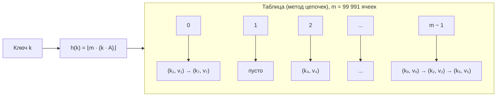
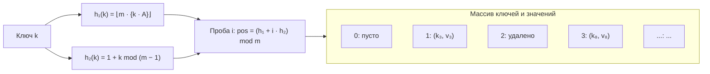
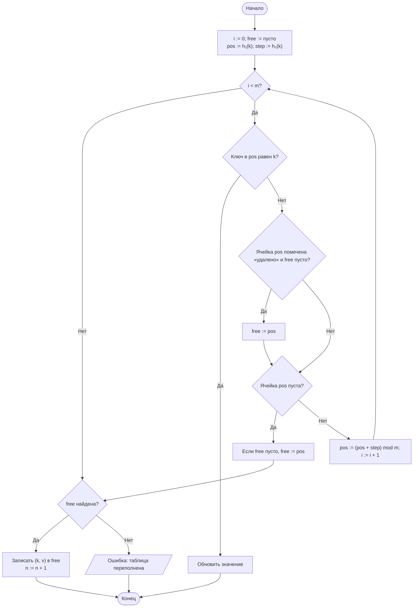
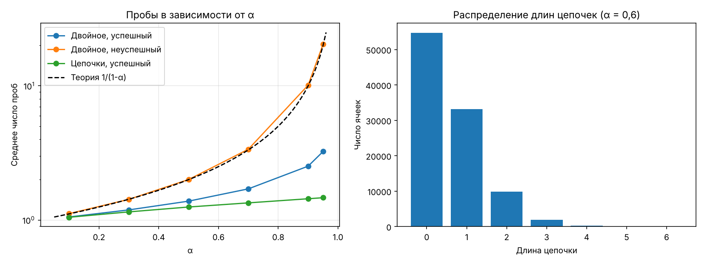

# Отчёт по лабораторной работе № 5

## Хеширование и экспериментальное исследование методов разрешения коллизий

---

## 1. Титульный лист

| | |
|---|---|
| **Дисциплина** | Теория алгоритмов |
| **Направление подготовки** | 38.03.05 «Бизнес-информатика» |
| **Курс** | 2 |
| **Лабораторная работа** | № 5. Хеширование и экспериментальное исследование методов разрешения коллизий |
| **Вариант** | 19 |
| **Выполнила** | Ситникова Ольга, группа БИ2-1 |
| **Проверил** | ______________________ |
| **Год** | 2026 |

---

## 2. Цель работы и задание варианта

**Цель работы:** изучить принципы хеширования как способа организации данных с временем доступа $O(1)$ в среднем, реализовать хеш-таблицу и экспериментально исследовать влияние хеш-функции и коэффициента заполнения на её производительность.

**Задание варианта 19:**

| Параметр | Значение |
|---|---|
| Тип ключей | целые случайные (уникальные, из диапазона $[0;\ 10^7)$) |
| Хеш-функция | У — метод умножения |
| Разрешение коллизий | Ц — метод цепочек и Дв — двойное хеширование |
| Число элементов $n$ | 60 000 |
| Размер таблицы $m$ | 99 991 (простое число) |
| Коэффициент заполнения | $\alpha = n / m \approx 0{,}600$ |
| Дополнительное задание | В5 — сравнить время работы собственной таблицы со встроенным `dict` на тех же данных и объяснить разницу |

**Что выполнено:**

1. Реализованы две хеш-таблицы с методами `insert`, `search`, `delete`, которые подсчитывают число проб.
2. Измерены время вставки и поиска, среднее число проб, распределение длин цепочек.
3. Построен график зависимости числа проб от $\alpha$ и сопоставлен с теоретической кривой $\frac{1}{1-\alpha}$.
4. Сравнены качественная и заведомо неудачная ($h(k) = k \bmod 10$) хеш-функции.
5. Собственные реализации сопоставлены со встроенным `dict` (дополнительное задание В5).

---

## 3. Описание хеш-функции и способов разрешения коллизий

### 3.1. Хеш-функция: метод умножения

$$h(k) = \lfloor m \cdot \{k \cdot A\} \rfloor, \qquad A = \frac{\sqrt{5} - 1}{2} \approx 0{,}618,$$

где $\{x\}$ — дробная часть числа $x$. Значение $h(k)$ лежит в диапазоне $[0;\ m-1]$. Константа $A$ (золотое сечение) обеспечивает хорошее рассеивание ключей, а размер $m$ при этом может быть произвольным. Результат зависит от всех разрядов ключа.

Для сравнения используется заведомо неудачная функция $h(k) = k \bmod 10$: она принимает всего 10 различных значений, поэтому почти все ключи попадают в 10 ячеек.

### 3.2. Метод цепочек

Каждая ячейка таблицы хранит список пар «ключ — значение» с одинаковым значением хеша. Коэффициент заполнения $\alpha = n/m$ равен средней длине цепочки и может быть больше единицы. Теоретическое среднее число просмотренных элементов:

| Поиск | Среднее число проб |
|---|---|
| Успешный | $1 + \dfrac{\alpha}{2}$ |
| Неуспешный | $\alpha$ |

В худшем случае (все ключи в одной ячейке) трудоёмкость равна $\Theta(n)$.

### 3.3. Двойное хеширование (открытая адресация)

Все элементы хранятся в массиве. Если ячейка занята, проверяется следующая по правилу

$$h_i(k) = \bigl(h_1(k) + i \cdot h_2(k)\bigr) \bmod m, \qquad i = 0, 1, 2, \ldots$$

где $h_1$ — метод умножения, а $h_2(k) = 1 + (k \bmod (m - 1))$ — второй хеш, определяющий шаг. Шаг лежит в диапазоне от 1 до $m-1$ и взаимно прост с $m$, так как число $m = 99\,991$ простое; поэтому последовательность проб пройдёт по **всем** ячейкам таблицы.

Требуется $\alpha < 1$. Теоретическое среднее число проб при равномерном хешировании:

| Поиск | Среднее число проб |
|---|---|
| Неуспешный | $\dfrac{1}{1 - \alpha}$ |
| Успешный | $\dfrac{1}{\alpha} \ln \dfrac{1}{1 - \alpha}$ |

**Удаление** выполняется не обнулением ячейки, а установкой метки «удалено» (tombstone): иначе была бы разорвана последовательность проб других ключей. Поиск проходит через такие ячейки, а вставка может использовать их повторно.

**Условное обозначение числа проб:** для цепочек — число просмотренных элементов цепочки, для двойного хеширования — число просмотренных ячеек.

---

## 4. Схема структуры данных

### 4.1. Метод цепочек



### 4.2. Двойное хеширование



### 4.3. Блок-схема вставки при двойном хешировании



---

## 5. Листинг программы

Файл `lab5_variant19.py` (Python 3.10+, для графиков нужна библиотека `matplotlib`). Каждая строка снабжена комментарием.

```python
"""Лабораторная работа № 5. Вариант 19. Ситникова Ольга, группа БИ2-1."""
import math  # корень из 5 для константы метода умножения
import platform  # сведения о компьютере
import random  # случайные ключи
import time  # замер времени
from collections import Counter  # подсчёт распределения длин цепочек
import matplotlib.pyplot as plt  # графики

N, M = 60_000, 99_991  # число ключей и размер таблицы по варианту 19 (M простое)
A = (math.sqrt(5) - 1) / 2  # константа метода умножения, около 0,618


def h_mul(k, m):  # хеш-функция метода умножения
    return int(m * ((k * A) % 1))  # дробная часть k*A, умноженная на m, с отбрасыванием дробной части


def h_bad(k, m):  # заведомо неудачная хеш-функция (для сравнения)
    return k % 10  # возможны только 10 различных значений


def h2(k, m):  # вторая хеш-функция (шаг при двойном хешировании)
    return 1 + k % (m - 1)  # шаг от 1 до m-1; так как m простое, шаг взаимно прост с m


class ChainTable:  # хеш-таблица с методом цепочек
    def __init__(self, m, h=h_mul):  # размер таблицы и хеш-функция
        self.m, self.h, self.n, self.probes = m, h, 0, 0  # параметры, число элементов, счётчик проб
        self.slots = [[] for _ in range(m)]  # каждая ячейка хранит свой список пар (ключ, значение)

    def insert(self, key, value):  # вставка (или обновление) пары
        chain = self.slots[self.h(key, self.m)]  # цепочка нужной ячейки
        for i, (k, _) in enumerate(chain):  # ищем ключ в цепочке
            self.probes += 1  # считаем просмотренный элемент
            if k == key:  # ключ уже есть
                chain[i] = (key, value)  # обновляем значение
                return  # вставка закончена
        chain.append((key, value))  # ключа нет: добавляем в конец цепочки
        self.n += 1  # увеличиваем число элементов

    def search(self, key):  # поиск значения по ключу
        for k, v in self.slots[self.h(key, self.m)]:  # просматриваем цепочку ячейки
            self.probes += 1  # считаем просмотренный элемент
            if k == key:  # нашли ключ
                return v  # возвращаем значение
        return None  # в цепочке ключа нет

    def delete(self, key):  # удаление по ключу
        chain = self.slots[self.h(key, self.m)]  # цепочка нужной ячейки
        for i, (k, _) in enumerate(chain):  # ищем ключ
            self.probes += 1  # считаем просмотренный элемент
            if k == key:  # нашли
                del chain[i]  # убираем пару из цепочки
                self.n -= 1  # уменьшаем число элементов
                return True  # удаление выполнено
        return False  # ключа не было


class DoubleHashTable:  # хеш-таблица с открытой адресацией и двойным хешированием
    EMPTY, DELETED = object(), object()  # метки «пусто» и «удалено» (tombstone)

    def __init__(self, m, h=h_mul):  # размер таблицы и первая хеш-функция
        self.m, self.h, self.n, self.probes = m, h, 0, 0  # параметры, число элементов, счётчик проб
        self.keys = [self.EMPTY] * m  # массив ключей, сначала все ячейки пусты
        self.vals = [None] * m  # массив значений

    def _seq(self, key):  # последовательность проб h_i(k) = (h1 + i*h2) mod m
        pos, step = self.h(key, self.m), h2(key, self.m)  # начальная позиция и шаг
        for _ in range(self.m):  # не больше m проб
            yield pos  # отдаём очередную позицию
            pos = (pos + step) % self.m  # переходим к следующей позиции

    def insert(self, key, value):  # вставка (или обновление) пары
        free = None  # первая подходящая для записи ячейка
        for pos in self._seq(key):  # идём по последовательности проб
            self.probes += 1  # считаем пробу
            k = self.keys[pos]  # ключ в текущей ячейке
            if k == key:  # ключ уже есть
                self.vals[pos] = value  # обновляем значение
                return  # вставка закончена
            if k is self.DELETED and free is None:  # запоминаем первую «удалённую» ячейку
                free = pos  # сюда можно записать, если ключа дальше нет
            if k is self.EMPTY:  # дошли до пустой ячейки: ключа в таблице нет
                free = pos if free is None else free  # выбираем место для записи
                break  # дальше искать не нужно
        if free is None:  # свободных ячеек не нашлось
            raise RuntimeError("Таблица переполнена")  # сообщаем об ошибке
        self.keys[free], self.vals[free] = key, value  # записываем пару
        self.n += 1  # увеличиваем число элементов

    def search(self, key):  # поиск значения по ключу
        for pos in self._seq(key):  # идём по последовательности проб
            self.probes += 1  # считаем пробу
            k = self.keys[pos]  # ключ в текущей ячейке
            if k is self.EMPTY:  # пустая ячейка обрывает поиск
                return None  # ключа нет
            if k == key:  # нашли ключ
                return self.vals[pos]  # возвращаем значение
        return None  # просмотрена вся таблица, ключа нет

    def delete(self, key):  # удаление по ключу
        for pos in self._seq(key):  # идём по последовательности проб
            self.probes += 1  # считаем пробу
            k = self.keys[pos]  # ключ в текущей ячейке
            if k is self.EMPTY:  # пустая ячейка: ключа нет
                return False  # удалять нечего
            if k == key:  # нашли ключ
                self.keys[pos], self.vals[pos] = self.DELETED, None  # ставим метку «удалено», а не обнуляем
                self.n -= 1  # уменьшаем число элементов
                return True  # удаление выполнено
        return False  # ключа не было


class StdDict(dict):  # обёртка над встроенным dict с тем же интерфейсом (задание В5)
    probes = 0  # у dict пробы не считаются

    def insert(self, key, value):  # вставка
        self[key] = value  # обычная запись в словарь

    def search(self, key):  # поиск
        return self.get(key)  # значение или None


def check(table, keys):  # проверка методов insert, search и delete
    for k in keys:  # вставляем все ключи
        table.insert(k, k)  # значением служит сам ключ
    for k in keys[::2]:  # удаляем каждый второй ключ
        assert table.delete(k)  # удаление должно пройти успешно
    assert all(table.search(k) is None for k in keys[::2])  # удалённые ключи не находятся
    assert all(table.search(k) == k for k in keys[1::2])  # остальные ключи по-прежнему находятся


def measure(table, keys, hits, misses):  # замер вставки и двух видов поиска
    t0 = time.perf_counter()  # начало замера вставки
    for k in keys:  # вставляем все ключи
        table.insert(k, k)  # одна вставка
    res = [time.perf_counter() - t0]  # общее время вставки, с
    for qs in (hits, misses):  # сначала успешные, затем неуспешные запросы
        table.probes = 0  # обнуляем счётчик проб
        t0 = time.perf_counter()  # начало замера поиска
        for q in qs:  # выполняем запросы
            table.search(q)  # один поиск
        res += [(time.perf_counter() - t0) / len(qs), table.probes / len(qs)]  # время и пробы на запрос
    return res  # [вставка, время успеха, пробы успеха, время неуспеха, пробы неуспеха]


if __name__ == "__main__":  # запуск только при прямом старте файла
    print(platform.platform(), "|", platform.processor() or platform.machine(), "| Python", platform.python_version())  # система
    rng = random.Random(42)  # генератор с фиксированным seed
    pool = rng.sample(range(10_000_000), 105_000)  # уникальные случайные целые ключи
    keys_of = lambda n: pool[:n]  # первые n ключей из набора
    misses = pool[-10_000:]  # 10 000 заведомо отсутствующих ключей (конец набора)
    hits_of = lambda n: rng.choices(pool[:n], k=10_000)  # 10 000 успешных запросов
    check(ChainTable(1009), pool[:500])  # проверка цепочек на малой таблице
    check(DoubleHashTable(1009), pool[:500])  # проверка двойного хеширования на малой таблице
    print(f"Проверка insert/search/delete пройдена. n = {N}, m = {M}, alpha = {N / M:.3f}\n")  # сообщение
    hits, chain = hits_of(N), ChainTable(M)  # запросы и таблица цепочек для основного опыта
    for name, t in (("Цепочки", chain), ("Двойное хеширование", DoubleHashTable(M)), ("dict", StdDict())):  # три реализации
        r = measure(t, keys_of(N), hits, misses)  # замеры на одних и тех же данных
        print(f"{name:<20} вставка {r[0]:.4f} с | поиск {r[1] * 1e6:.3f} мкс, проб {r[2]:.2f} | промах {r[3] * 1e6:.3f} мкс, проб {r[4]:.2f}")  # строка результата
    lens = Counter(len(c) for c in chain.slots)  # сколько ячеек имеют цепочку каждой длины
    print("Распределение длин цепочек:", dict(sorted(lens.items())))  # печатаем распределение
    print("\nСравнение хеш-функций (цепочки, n = 60000):")  # заголовок сравнения
    for name, h in (("Умножения", h_mul), ("k mod 10", h_bad)):  # хорошая и плохая функции
        t = ChainTable(M, h)  # новая таблица с выбранной функцией
        r = measure(t, keys_of(N), hits, misses)  # замеры
        used = sum(1 for c in t.slots if c)  # число занятых ячеек
        print(f"{name:<10} занято ячеек {used}, коллизий {N - used}, макс. цепочка {max(map(len, t.slots))}, проб при поиске {r[2]:.1f}, вставка {r[0]:.2f} с")  # результат
    alphas = [0.1, 0.3, 0.5, 0.7, 0.9, 0.95]  # значения коэффициента заполнения
    exp = {"Двойное, успешный": [], "Двойное, неуспешный": [], "Цепочки, успешный": []}  # результаты для графика
    print("\nalpha | двойное: успех / промах | цепочки: успех / промах | время успешного поиска, мкс (двойное / цепочки)")  # заголовок
    for a in alphas:  # перебираем alpha
        n = int(a * M)  # число ключей для данного alpha
        hs = hits_of(n)  # успешные запросы для n ключей
        d = measure(DoubleHashTable(M), keys_of(n), hs, misses)  # двойное хеширование
        c = measure(ChainTable(M), keys_of(n), hs, misses)  # цепочки
        exp["Двойное, успешный"].append(d[2])  # пробы при успешном поиске
        exp["Двойное, неуспешный"].append(d[4])  # пробы при неуспешном поиске
        exp["Цепочки, успешный"].append(c[2])  # пробы цепочек при успешном поиске
        print(f"{a:.2f}  | {d[2]:.2f} / {d[4]:.2f} | {c[2]:.2f} / {c[4]:.2f} | {d[1] * 1e6:.3f} / {c[1] * 1e6:.3f}")  # строка таблицы
    fig, (ax1, ax2) = plt.subplots(1, 2, figsize=(12, 4.5))  # два графика рядом
    for name, ys in exp.items():  # экспериментальные линии
        ax1.plot(alphas, ys, "o-", label=name)  # проб в зависимости от alpha
    xs = [i / 100 for i in range(5, 97)]  # плотная сетка alpha для теоретической кривой
    ax1.plot(xs, [1 / (1 - x) for x in xs], "k--", label="Теория 1/(1-α)")  # теория для неуспешного поиска
    ax1.set(xlabel="α", ylabel="Среднее число проб", title="Пробы в зависимости от α", yscale="log")  # оформление
    ax2.bar(list(lens), list(lens.values()))  # столбики: длина цепочки -> число ячеек
    ax2.set(xlabel="Длина цепочки", ylabel="Число ячеек", title="Распределение длин цепочек (α = 0,6)")  # оформление
    ax1.legend()  # легенда левого графика
    ax1.grid(True, alpha=0.3)  # сетка левого графика
    plt.tight_layout()  # убираем наложение подписей
    plt.savefig("lab5_graphs.png", dpi=150)  # сохраняем график для отчёта
    plt.show()  # показываем график на экране
```

---

## 6. Таблицы измерений и графики

**Условия измерений:** Linux (Ubuntu 24.04), Intel Xeon @ 2,10 ГГц (1 виртуальное ядро), 3 ГБ ОЗУ, Python 3.12.3, matplotlib 3.11; время измерялось `time.perf_counter()`. Ключи — случайные уникальные целые числа (`seed = 42`), запросов каждого вида 10 000: успешные (случайные вставленные ключи) и неуспешные (заведомо отсутствующие ключи). Правильность `insert`, `search` и `delete` проверена функцией `check` на таблицах размером 1009: после удаления половины ключей они не находятся, а оставшиеся находятся.

### 6.1. Основной опыт: $n = 60\,000$, $m = 99\,991$, $\alpha = 0{,}600$

**Таблица 1. Время и число проб**

| Реализация | Время вставки 60 000 ключей, с | Успешный поиск, мкс | Проб (успешный) | Неуспешный поиск, мкс | Проб (неуспешный) |
|---|---|---|---|---|---|
| Метод цепочек | 0,0563 | 1,389 | 1,29 | 1,019 | 0,60 |
| Двойное хеширование | 0,0883 | 1,200 | 1,52 | 1,128 | 2,52 |
| Встроенный `dict` | 0,0088 | 0,182 | — | 0,117 | — |

**Таблица 2. Сопоставление с теорией при $\alpha = 0{,}600$**

| Показатель | Измерено | Теория |
|---|---|---|
| Цепочки, успешный поиск | 1,29 | $1 + \alpha/2 = 1{,}30$ |
| Цепочки, неуспешный поиск | 0,60 | $\alpha = 0{,}60$ |
| Двойное хеширование, успешный поиск | 1,52 | $\frac{1}{\alpha}\ln\frac{1}{1-\alpha} = 1{,}53$ |
| Двойное хеширование, неуспешный поиск | 2,52 | $\frac{1}{1-\alpha} = 2{,}50$ |

### 6.2. Распределение длин цепочек (метод цепочек, $\alpha = 0{,}600$)

**Таблица 3.** Теоретическое число ячеек получено по закону Пуассона: $m \cdot e^{-\alpha}\alpha^k / k!$.

| Длина цепочки | 0 | 1 | 2 | 3 | 4 | 5 | 6 |
|---|---|---|---|---|---|---|---|
| Число ячеек (опыт) | 54 702 | 33 187 | 9850 | 1934 | 283 | 31 | 4 |
| Число ячеек (теория) | 54 873 | 32 927 | 9879 | 1976 | 296 | 36 | 4 |

Максимальная длина цепочки равна 6, пустых ячеек 54 702 из 99 991 (55 %). Распределение показано на правом графике.

### 6.3. Зависимость числа проб от коэффициента заполнения

**Таблица 4. Среднее число проб и время успешного поиска**

| $\alpha$ | Двойное: успешный (опыт / теория) | Двойное: неуспешный (опыт / теория $\frac{1}{1-\alpha}$) | Цепочки: успешный (опыт / теория) | Цепочки: неуспешный (опыт / теория) | Время успешного поиска, мкс (двойное / цепочки) |
|---|---|---|---|---|---|
| 0,10 | 1,05 / 1,05 | 1,12 / 1,11 | 1,05 / 1,05 | 0,10 / 0,10 | 0,489 / 0,395 |
| 0,30 | 1,19 / 1,19 | 1,43 / 1,43 | 1,15 / 1,15 | 0,30 / 0,30 | 0,555 / 0,554 |
| 0,50 | 1,38 / 1,39 | 2,00 / 2,00 | 1,25 / 1,25 | 0,50 / 0,50 | 0,601 / 0,677 |
| 0,70 | 1,71 / 1,72 | 3,37 / 3,33 | 1,34 / 1,35 | 0,69 / 0,70 | 0,728 / 0,893 |
| 0,90 | 2,52 / 2,56 | 10,11 / 10,00 | 1,44 / 1,45 | 0,90 / 0,90 | 0,932 / 0,987 |
| 0,95 | 3,24 / 3,15 | 20,38 / 20,00 | 1,47 / 1,48 | 0,94 / 0,95 | 1,285 / 1,041 |

**График** (слева — число проб в зависимости от $\alpha$ с теоретической кривой $\frac{1}{1-\alpha}$, ось ординат логарифмическая; справа — распределение длин цепочек):



### 6.4. Качественная и неудачная хеш-функции (метод цепочек, $n = 60\,000$, $m = 99\,991$)

**Таблица 5.** Коллизией считается ключ, попавший в уже занятую ячейку: число коллизий равно $n$ минус число занятых ячеек.

| Хеш-функция | Занято ячеек | Коллизий | Максимальная цепочка | Проб при успешном поиске | Время вставки, с |
|---|---|---|---|---|---|
| Метод умножения | 45 289 | 14 711 | 6 | 1,3 | 0,08 |
| $h(k) = k \bmod 10$ | 10 | 59 990 | 6117 | 2984,4 | 12,95 |

Для неудачной функции из 99 991 ячеек используются только 10, поэтому цепочки содержат около 6000 элементов, а таблица вырождается в десять списков.

---

## 7. Результат выполнения дополнительного задания В5

Задание: сравнить время работы собственной таблицы со встроенным `dict` на тех же данных ($n = 60\,000$, одинаковые запросы) и объяснить разницу.

**Таблица 6. Собственные таблицы и `dict`**

| Операция | Цепочки | Двойное хеширование | `dict` | Цепочки / `dict` | Двойное / `dict` |
|---|---|---|---|---|---|
| Вставка 60 000 ключей, с | 0,0563 | 0,0883 | 0,0088 | 6,4 | 10,0 |
| Успешный поиск, мкс | 1,389 | 1,200 | 0,182 | 7,6 | 6,6 |
| Неуспешный поиск, мкс | 1,019 | 1,128 | 0,117 | 8,7 | 9,6 |

Встроенный `dict` быстрее собственных реализаций в 6–10 раз. Причины:

1. **Реализация на C.** Все операции `dict` выполняются в скомпилированном коде интерпретатора, а в собственных классах каждая проба проходит через байт-код Python: вызовы методов и хеш-функции, создание временных объектов, арифметика над объектами `int` и `float`, обновление счётчика `probes`.
2. **Более дешёвая хеш-функция.** Для целых чисел `dict` использует встроенную функцию `hash` (значение ключа по модулю константы), которая вычисляется за несколько машинных операций. Наш метод умножения требует умножения чисел с плавающей точкой, взятия дробной части и преобразования в `int`.
3. **Оптимизированная схема пробирования.** `dict` использует открытую адресацию с псевдослучайным пробированием, хранит в компактной таблице индексов и массиве записей и рассчитан на хорошую работу кэша процессора. Наши списки пар и отдельных объектов расположены в памяти менее компактно.
4. **Автоматическое расширение.** `dict` сам поддерживает невысокий коэффициент заполнения (расширяется, когда таблица заполнена примерно на две трети), а собственные таблицы работают при фиксированном $\alpha = 0{,}6$ и не расширяются.

При этом асимптотика у всех трёх реализаций одинакова: $\Theta(1)$ в среднем. Различается только константный множитель.

---

## 8. Выводы

1. Экспериментальное число проб хорошо согласуется с теорией. При $\alpha = 0{,}6$ метод цепочек даёт 1,29 пробы при успешном поиске (теория 1,30) и 0,60 при неуспешном (теория 0,60); двойное хеширование — 1,52 (теория 1,53) и 2,52 (теория 2,50). Метод умножения распределяет ключи близко к равномерному: распределение длин цепочек практически совпадает с распределением Пуассона.
2. Метод цепочек устойчивее к росту коэффициента заполнения: число проб растёт линейно по $\alpha$ (от 1,05 до 1,47 при росте $\alpha$ от 0,1 до 0,95). При двойном хешировании число проб при неуспешном поиске растёт как $\frac{1}{1-\alpha}$: 2,0 при $\alpha = 0{,}5$, 10,1 при $\alpha = 0{,}9$ и 20,4 при $\alpha = 0{,}95$. Поэтому открытую адресацию нужно расширять заранее, не доводя $\alpha$ до значений, близких к единице.
3. Двойное хеширование даёт близкие к теоретическим значения для равномерного хеширования: первичной кластеризации (как при линейном пробировании) не возникает, потому что шаг зависит от ключа. Платой за это являются дополнительное вычисление $h_2$ и необходимость простого $m$ (или другого гарантированно взаимно простого с шагом размера).
4. Качество хеш-функции критично. Неудачная функция $k \bmod 10$ использует только 10 из 99 991 ячеек и вызывает 59 990 коллизий вместо 14 711; среднее число проб при поиске вырастает с 1,3 до 2984 (примерно в 2300 раз), а время вставки — с 0,08 до 12,95 с. Таблица вырождается в набор списков, и трудоёмкость становится $\Theta(n)$ вместо $\Theta(1)$.
5. По дополнительному заданию В5 встроенный `dict` в 6–10 раз быстрее собственных таблиц из-за реализации на C, более простой хеш-функции и оптимизированной структуры данных; порядок роста у всех реализаций один и тот же. Собственные реализации имеют учебное значение и позволяют наблюдать внутренние характеристики (число проб, длины цепочек), недоступные через интерфейс `dict`.
6. Хеш-таблица даёт поиск и вставку за $\Theta(1)$ в среднем, но не хранит ключи упорядоченно: она не подходит для запросов по диапазону ключей и вывода данных по возрастанию — для них нужны упорядоченный массив или дерево.
